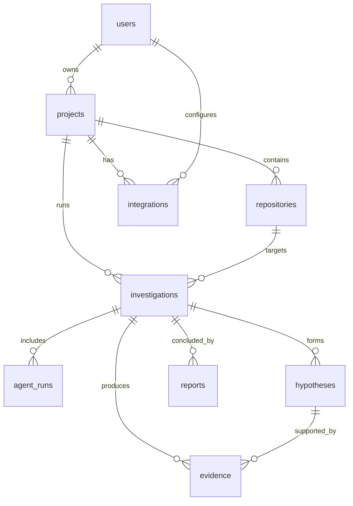

# Data Architecture

> Phase 01 note: no database is wired yet. This document specifies the intended
> relational (PostgreSQL/Supabase) and vector (ChromaDB) data model so later
> phases can implement it without restructuring.

## Relational model (PostgreSQL / Supabase)

### Entities

```
users
projects
repositories
integrations
investigations
agent_runs
evidence
hypotheses
reports
```

### Relationships



### Entity sketch

| Entity         | Purpose                                                          | Key fields                                            |
| -------------- | ---------------------------------------------------------------- | ----------------------------------------------------- |
| `users`        | Account holders                                                   | id, email, auth provider ref                          |
| `projects`     | A connected software project                                      | id, owner_id, name                                   |
| `repositories` | Repositories belonging to a project                               | id, project_id, provider, remote_url, default_branch  |
| `integrations` | External connections (GitHub, log, metrics) per project           | id, project_id, provider, scopes, credential ref      |
| `investigations`| One root-cause investigation of a problem                         | id, project_id, question, status, timestamps          |
| `agent_runs`   | A single agent execution within an investigation                  | id, investigation_id, agent_name, status, output      |
| `evidence`     | A unit of evidence with an attributed source                      | id, investigation_id, kind, source, content, hash     |
| `hypotheses`   | Working hypotheses and critic verdicts                            | id, investigation_id, statement, status, verdict      |
| `reports`      | Final investigation reports                                       | id, investigation_id, summary, root_cause, full_text  |

Design notes:

- **Evidence is append-only.** Evidence represents observed facts and is never
  edited after capture; corrections add new evidence that supersedes old rows.
- **Credentials are references, not values.** `integrations` stores pointers to
  secrets held in a managed secret store, never the secrets themselves.
- **Status enums** (`investigations.status`, `agent_runs.status`,
  `hypotheses.status`) drive the SSE event stream and the Critic loop.

## Vector store (ChromaDB)

ChromaDB hosts embeddings for semantic search over repository context:

- Code chunks (per repository, language-aware splitting)
- Documentation chunks
- Repository-level context (structure, conventions, dependency maps)
- Investigation evidence embeddings for similarity across investigations

Collections are namespaced per project/repository using a prefix such as
`argus-{project}-{repo}` (configurable via `CHROMA_COLLECTION_PREFIX`).

Purpose: let agents find relevant code, docs, and past evidence by meaning
rather than exact string match — and let the Correlation Agent see whether the
current problem resembles a previously investigated one.

## Current phase

Phase 01 wires no database. `.env.example` reserves `DATABASE_URL` and ChromaDB
connection variables so the local environment is ready for Phase 02.